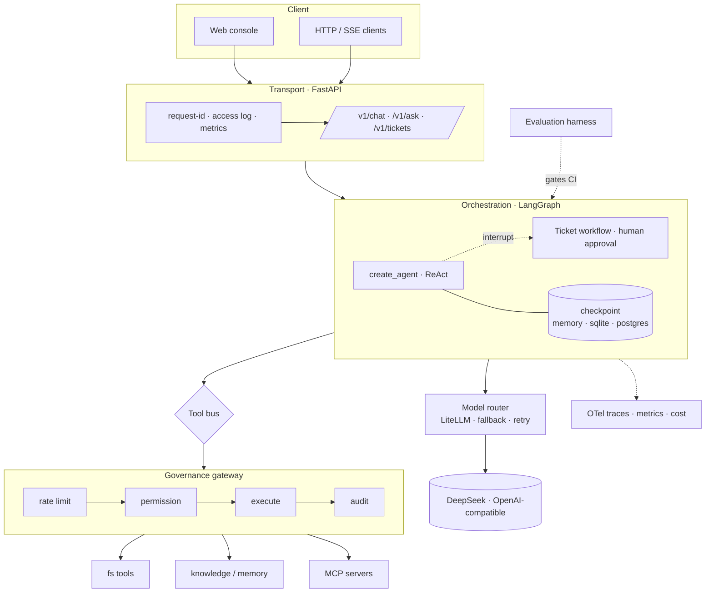

# Bailiff

**Your agent works in a notebook. This is what it takes to put it in production.**

A production-grade agent runtime: every tool call goes through auth → permission → rate limit → audit, every step is checkpointed, every token is costed, and every release is gated by an evaluation suite.

[](../../actions)
[](tests/)
[](pyproject.toml)
[](pyproject.toml)
[](LICENSE)
[](agent_platform/gateway/mcp_client.py)

[中文文档](README.zh-CN.md) · [Architecture](docs/architecture.md) · [API](docs/api.md) · [Operations](docs/operations.md) · [Security](docs/security.md) · [ADRs](docs/adr/)

---

## 60-second demo (no API key needed)

```bash
git clone https://github.com/southcloud372/Bailiff.git && cd Bailiff
docker compose -f docker-compose.demo.yml up --build
# open http://localhost:8000 → click "演示登录" / "Demo login" → chat
```

Without a key the model falls back to a deterministic offline model. The whole chain — auth, rate limiting, input guardrails, graph orchestration, SSE streaming, cost accounting, metrics, audit — runs for real; only the reasoning is faked. Point `DEEPSEEK_API_KEY` at a real key and nothing else changes.

Or run it locally:

```bash
uv sync --extra prod          # Python 3.13 + uv
cp .env.example .env          # optional: fill DEEPSEEK_API_KEY
uv run python scripts/ingest.py   # load the sample corpus (no external service)
uv run python scripts/serve.py
```

## What's actually in here

| Capability | Where | Why it matters |
|---|---|---|
| **Tool governance** | `gateway/gateway.py` | Rate limit → permission → existence → execute → audit. Agents never call tools directly, so a prompt injection can't reach the filesystem. |
| **Checkpointed graph** | `core/checkpoint.py` | `memory` / `sqlite` / `postgres` backends. A human-approval interrupt survives a process restart, which naive `MemorySaver` demos get wrong. |
| **MCP gateway** | `gateway/mcp_client.py` | Dynamic `tools/list` discovery, namespace prefixing, per-server fault isolation, stdio + Streamable HTTP. |
| **Reasoning-model adapter** | `router/deepseek.py` | Passes `reasoning_content` back on tool-call turns and repairs dangling `tool_calls` in history. See [field notes](#field-notes-two-bugs-you-will-hit). |
| **Cost accounting** | `router/cost.py`, `router/budget.py` | Token-level callback metering, hard budget caps (402), cache-hit pricing, per-model breakdown. |
| **Retrieval** | `knowledge/` | Local SQLite backend works with zero infrastructure; pgvector + HNSW when you scale. Metadata is filtered before ranking, so tenant scoping cannot silently drop recall. |
| **Evaluation in CI** | `evaluation/`, `scripts/eval.py` | `pass@k` for model selection, `pass^k` for reliability. Non-zero exit code blocks the release. |
| **Observability** | `observability/` | `/healthz` vs `/readyz` (liveness ≠ readiness), Prometheus `/metrics`, OTel `gen_ai.*` spans → Langfuse. |
| **Guardrails** | `guardrails/guards.py` | Input injection detection before the model, PII masking before the response. |
| **Egress with SSRF defence** | `tools/web.py` | Domain allowlist (deny by default), DNS-resolved IP check, per-hop redirect revalidation, byte cap. Off unless configured. |
| **Read-only mode** | `gateway/wiring.py` | `AGENT_READ_ONLY=true` removes write tools from the registry entirely — capability absent, not denied. |

## Architecture



The point of the layout: **orchestration decides, governance enforces**. The agent can ask for anything; only the gateway can do it.

## Field notes: two bugs you will hit

These are not tutorial bugs. Both only appear once an agent does *multi-step* work with a reasoning model, and both cost us a full day.

### 1. `reasoning_content` must be passed back on tool-call turns

DeepSeek V4.1-Flash returns `reasoning_content` alongside `content`. Its API requires that an assistant message carrying `tool_calls` **pass the reasoning back** on the next request:

```
The `reasoning_content` in the thinking mode must be passed back to the API.
```

LangChain's `ChatOpenAI` drops `additional_kwargs` when serialising tool-call messages, so the very first tool call succeeds and **the second model turn fails with 400**. Plain chat works fine, which is why a demo never catches it.

Fix: [`router/deepseek.py`](agent_platform/router/deepseek.py) overrides `_get_request_payload` and re-attaches the field.

### 2. One failed tool call bricks the whole thread, permanently

OpenAI-compatible APIs require every `tool_call_id` to be answered by a `tool` message. If a tool raises and the exception propagates, the checkpoint is written with *N tool calls and N−1 results*. From then on **every** request on that thread fails with:

```
An assistant message with 'tool_calls' must be followed by tool messages...
```

The error never mentions the real cause, and it is sticky: the thread is dead for good.

Fix, in two layers.
1. All tool exceptions — including permission denials — are converted into structured results (`{"ok": false, "kind": "permission_denied", ...}`) so the model can explain the failure instead of the process dying. Governance still happens in the gateway; audit still records it.
2. `_repair_dangling_tool_calls` backfills missing tool messages on the way out, so already-corrupted threads self-heal.

Regression tests: [`tests/test_deepseek_payload.py`](tests/test_deepseek_payload.py).

## API

| Method | Path | Notes |
|---|---|---|
| GET | `/healthz` | Liveness only, never touches downstream |
| GET | `/readyz` | Concurrent dependency probes; any critical failure → 503 (drain traffic, don't restart) |
| GET | `/metrics` | Prometheus text format, zero extra dependencies |
| POST | `/v1/chat` | Stateful, multi-turn (checkpointed by `thread_id`) |
| POST | `/v1/chat/stream` | SSE with typed events: `reasoning` · `delta` · `tool_call` · `tool_result` |
| POST | `/v1/ask` | Stateless single-shot, eligible for semantic cache |
| GET | `/v1/cost` | Per-model cost, tokens, cache hit rate |
| POST | `/v1/tickets` | Start a human-approval workflow; `/{id}/resume` continues after `interrupt()` |
| GET/DELETE | `/v1/cache` | Semantic cache stats / purge |
| POST | `/mcp/fs/mcp` | Filesystem exposed as an MCP server (stateless Streamable HTTP) |
| POST | `/v1/auth/dev-token` | **dev only**; not registered outside `AGENT_ENV=dev` |

```bash
TOKEN=$(curl -s -X POST localhost:8000/v1/auth/dev-token -H 'content-type: application/json' -d '{}' | jq -r .token)
curl -N -X POST localhost:8000/v1/chat/stream \
  -H "authorization: Bearer $TOKEN" -H 'content-type: application/json' \
  -d '{"message":"write hello to note.txt, then read it back"}'
```

```text
data: {"type":"reasoning","text":"用户要求先写入..."}
data: {"type":"tool_call","name":"write_file","args":""}
data: {"type":"tool_result","name":"write_file","text":"/app/data/fs/note.txt"}
data: {"type":"delta","text":"已写入","delta":"已写入"}
data: [DONE]
```

## Why not just…

| | Dify / Flowise | LangGraph template | This |
|---|---|---|---|
| Multi-step autonomous agent | Visual flows, limited | Yes | Yes |
| Tool-level authorization | Workspace roles | Roll your own | Role→tool policy + audit on every call |
| Durable human approval | Partial | `interrupt()` + your own saver | `interrupt()` + three saver backends, tested across restart |
| Cost control | Usage dashboard | — | Hard cap, per-turn, returns 402 |
| Failure containment | — | — | Tool errors become observations; threads self-heal |
| Release gate | Manual | — | `pass^k` eval in CI, non-zero exit |

Pick Dify if you want a visual builder. Pick this if you want to read, audit and own the runtime.

## Deploy

```bash
# Single container (console included, no nginx)
docker build -f deploy/Dockerfile -t bailiff .

# Full stack: Postgres 18 + pgvector, Redis 8, app
docker compose up -d
```

Production knobs (all env vars, no code change):

| Variable | Default | Production |
|---|---|---|
| `AGENT_ENV` | `dev` | `prod` — refuses to boot on a demo JWT secret |
| `AGENT_CHECKPOINT_BACKEND` | `sqlite` | `postgres` |
| `AGENT_RATE_LIMIT_BACKEND` | `memory` | `redis` (Lua sliding window, degrades to local bucket instead of failing open) |
| `AGENT_LLM_BACKEND` | `auto` | `deepseek` — fail loudly instead of silently mocking |

`/readyz` reports the resolved backends, so a misconfigured deployment is visible before it serves traffic.

## Quality gates

```bash
make check     # ruff + mypy --strict + pytest
```

`ruff` clean across 9 rule families · `mypy --strict` 55 files, 0 issues · 184 tests, 1 skipped (Postgres integration, needs Docker).

## Roadmap

See [ROADMAP.md](ROADMAP.md). Next up: trajectory-level eval scoring, A2A interop, prompt-injection corpus, K8s manifests.

## Contributing

Issues and PRs welcome — start with [CONTRIBUTING.md](CONTRIBUTING.md). Good first issues are tagged [`good first issue`](../../labels/good%20first%20issue).

## License

MIT — see [LICENSE](LICENSE).
