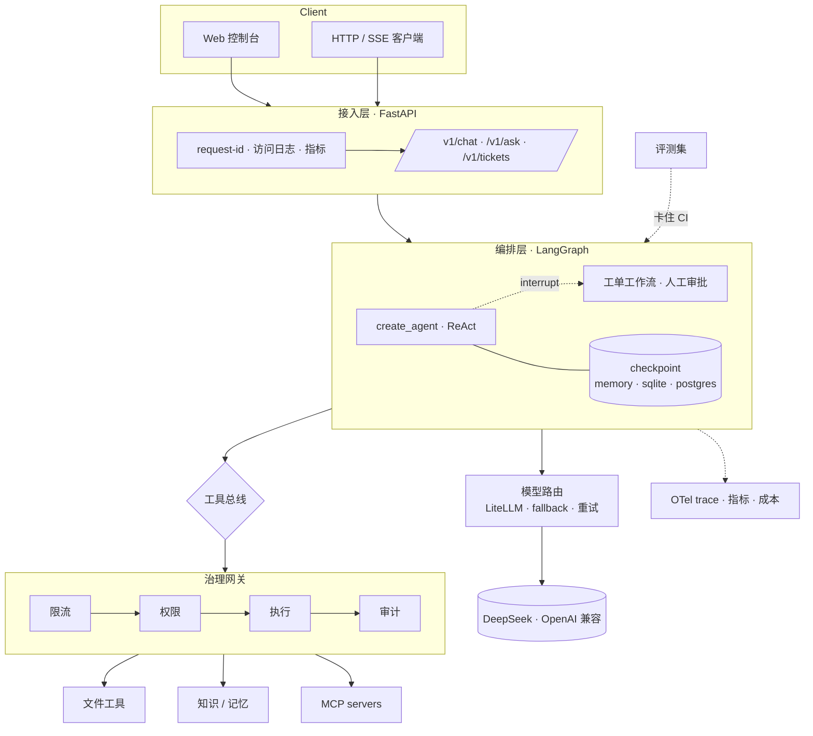

# Bailiff

**[English](README.md) | 简体中文**

**你的 Agent 在 notebook 里跑得通。这里讲的是把它放进生产要补什么。**

一个生产级 Agent 运行时：每次工具调用都经过 鉴权 → 权限 → 限流 → 审计，每一步状态都落 checkpoint，
每个 token 都计入成本，每次发版都被评测集拦住。

[](../../actions)
[](tests/)
[](pyproject.toml)
[](pyproject.toml)
[](LICENSE)

[架构说明](docs/architecture.md) · [API 参考](docs/api.md) · [运维手册](docs/operations.md) · [安全模型](docs/security.md)

---

## 60 秒跑起来（不需要 API Key）

```bash
git clone https://github.com/southcloud372/Bailiff.git && cd Bailiff
docker compose -f docker-compose.demo.yml up --build
# 打开 http://localhost:8000 → 点「演示登录」→ 直接对话
```

没有 key 时模型自动降级为**离线演示模型**：鉴权、限流、输入护栏、图编排、SSE 流式、成本记账、
指标、审计全部走真实代码路径，只有「推理」是假的。填上 `DEEPSEEK_API_KEY` 后无需改任何代码。

本地跑：

```bash
uv sync --extra prod          # Python 3.13 + uv
cp .env.example .env          # 可选：填 DEEPSEEK_API_KEY
uv run python scripts/ingest.py   # 灌入示例语料，不依赖任何外部服务
uv run python scripts/serve.py
```

## 里面到底有什么

| 能力 | 位置 | 为什么重要 |
|---|---|---|
| **工具治理** | `gateway/gateway.py` | 限流 → 权限 → 存在性 → 执行 → 审计。Agent 不直接持有函数，提示词注入拿不到文件系统。 |
| **可持久化图状态** | `core/checkpoint.py` | memory / sqlite / postgres 三种后端。人工审批的 `interrupt()` 能跨进程重启存活，这是 `MemorySaver` demo 最常翻车的地方。 |
| **MCP 网关** | `gateway/mcp_client.py` | `tools/list` 动态发现、命名空间前缀、单 server 故障隔离、stdio + Streamable HTTP。 |
| **思考模型适配** | `router/deepseek.py` | 工具调用轮次回传 `reasoning_content`，并修复历史里悬空的 `tool_calls`。见下方「两个真实坑」。 |
| **成本核算** | `router/cost.py`、`router/budget.py` | token 级回调计费、预算硬限额（402）、上下文缓存命中单独计价、按模型拆分。 |
| **检索** | `knowledge/` | 默认本地 SQLite 后端，零基础设施可用；上规模后切 pgvector + HNSW。metadata 先过滤后排序，租户隔离不会悄悄丢召回。 |
| **评测进门禁** | `evaluation/`、`scripts/eval.py` | 选模型看 `pass@k`，上线看 `pass^k`；不达标 CI 直接非零退出。 |
| **可观测** | `observability/` | `/healthz` 与 `/readyz` 语义分离、Prometheus `/metrics`、OTel `gen_ai.*` → Langfuse。 |
| **护栏** | `guardrails/guards.py` | 模型之前拦注入，返回之前脱敏。 |
| **出网 + SSRF 防护** | `tools/web.py` | 域名白名单（默认拒绝）、DNS 解析后校验 IP、逐跳复检重定向、字节上限。不配置就不注册。 |
| **只读模式** | `gateway/wiring.py` | `AGENT_READ_ONLY=true` 时写入工具**不注册**，能力不存在，而不是存在但拒绝。 |

## 架构



一句话：**编排层决定「想做什么」，治理层决定「能不能做」。**

## 两个真实坑

不是教程里的坑。只有 Agent 真的做**多步任务**、且用思考模型时才会撞上，两个都花了一整天。

### 1. 工具调用轮次必须回传 `reasoning_content`

DeepSeek V4.1-Flash 会同时返回 `reasoning_content` 和 `content`。它的 API 要求：**带 `tool_calls`
的 assistant 消息，在下一轮请求里必须把推理内容一起传回**，否则：

```
The `reasoning_content` in the thinking mode must be passed back to the API.
```

而 LangChain 的 `ChatOpenAI` 序列化时会丢掉 `additional_kwargs`，于是**第一次工具调用成功、
第二次模型调用必 400**。纯聊天完全正常，所以 demo 永远测不出来。

修复：[`router/deepseek.py`](agent_platform/router/deepseek.py) 覆写 `_get_request_payload` 补回该字段。

### 2. 一次失败的工具调用，会把整条会话线程永久写坏

OpenAI 兼容 API 要求每个 `tool_call_id` 都有对应的 `tool` 消息。如果某个工具抛异常向上传播，
checkpoint 里就会留下「N 个 tool_calls + N−1 个结果」。从此这条线程**每一轮**都失败：

```
An assistant message with 'tool_calls' must be followed by tool messages...
```

报错与真实原因毫无关系，而且是**粘性**的，线程永久坏死。

修复分两层：
1. **所有**工具异常（含越权、限流、沙箱拒绝）都转成结构化结果
   `{"ok": false, "kind": "permission_denied", ...}`，让模型向用户解释，而不是让进程崩掉。
   治理并没有被削弱：拒绝仍发生在网关，审计照样落库。
2. `_repair_dangling_tool_calls` 在序列化时补齐缺失的 tool 消息，已经坏掉的线程能自愈。

回归测试：[`tests/test_deepseek_payload.py`](tests/test_deepseek_payload.py)。

## API 一览

| 方法 | 路径 | 说明 |
|---|---|---|
| GET | `/healthz` | 存活探针，绝不碰下游 |
| GET | `/readyz` | 并发探测依赖，critical 失败 → 503（摘流量而不是重启） |
| GET | `/metrics` | Prometheus 文本格式，零额外依赖 |
| POST | `/v1/chat` | 有状态多轮（按 `thread_id` 落 checkpoint） |
| POST | `/v1/chat/stream` | SSE，事件分类型：`reasoning` · `delta` · `tool_call` · `tool_result` |
| POST | `/v1/ask` | 无状态单轮，可走语义缓存 |
| GET | `/v1/cost` | 按模型的成本、token、缓存命中率 |
| POST | `/v1/tickets` | 发起人工审批工作流；`/{id}/resume` 审批后继续 |
| GET/DELETE | `/v1/cache` | 语义缓存统计 / 清空 |
| POST | `/mcp/fs/mcp` | 把文件系统暴露成 MCP server（无状态 Streamable HTTP） |
| POST | `/v1/auth/dev-token` | **仅 dev**，非 `AGENT_ENV=dev` 时这条路由根本不注册 |

## 为什么不直接用…

| | Dify / Flowise | LangGraph 模板 | 本项目 |
|---|---|---|---|
| 多步自主 Agent | 可视化流程，有限 | 支持 | 支持 |
| 工具级授权 | 工作区角色 | 自己写 | 角色→工具策略 + 每次调用落审计 |
| 可持久的人工审批 | 部分 | `interrupt()` + 自备 saver | `interrupt()` + 三种 saver，跨重启测过 |
| 成本控制 | 用量看板 | 无 | 硬限额，超限 402 |
| 故障隔离 | 无 | 无 | 工具异常变观察值；会话线程自愈 |
| 发版门禁 | 人工 | 无 | `pass^k` 评测卡 CI，非零退出 |

要可视化编排选 Dify；要能读懂、能审计、能自己掌控运行时，选这个。

## 部署

```bash
# 单容器（含控制台，不需要 nginx）
docker build -f deploy/Dockerfile -t bailiff .

# 完整栈：Postgres 18 + pgvector、Redis 8、应用
docker compose up -d
```

生产开关（全走环境变量，不改代码）：

| 变量 | 默认 | 生产 |
|---|---|---|
| `AGENT_ENV` | `dev` | `prod`，示例 JWT 密钥直接拒绝启动 |
| `AGENT_CHECKPOINT_BACKEND` | `sqlite` | `postgres` |
| `AGENT_RATE_LIMIT_BACKEND` | `memory` | `redis`（Lua 滑动窗口，故障时降级到本地桶而不是放行） |
| `AGENT_LLM_BACKEND` | `auto` | `deepseek`，缺 key 直接报错，不静默用假模型 |

`/readyz` 会报出实际生效的后端，配置错了在接流量之前就能看见。

## 质量门

```bash
make check     # ruff + mypy --strict + pytest
```

ruff 9 类规则全绿 · mypy --strict 55 文件 0 issue · 184 测试通过、1 跳过（Postgres 集成测试，需 Docker）。

## 路线图

见 [ROADMAP.md](ROADMAP.md)。近期：轨迹级评测、A2A 互通、注入攻击测试集、K8s 清单。

## 参与

欢迎 issue 与 PR，先读 [CONTRIBUTING.md](CONTRIBUTING.md)。

## 许可

MIT，见 [LICENSE](LICENSE)。
